# Radar & Image Signal Processing – MATLAB · Simulink · Python

Raccolta di simulazioni che ho sviluppato per consolidare, con il codice, gli argomenti di **elaborazione dei segnali radar** e di **elaborazione delle immagini** studiati durante la laurea magistrale in Ingegneria delle Telecomunicazioni (Sapienza Università di Roma).

Per ogni argomento ho scritto lo **stesso esperimento in Python e in MATLAB**, con parametri identici, e ho confrontato i risultati numerici con i valori attesi dalla teoria. Per gli argomenti più vicini all'implementazione in tempo reale (campionamento, quantizzazione, filtraggio FIR, cancellazione del clutter) ho costruito anche dei **modelli Simulink**, generati da script.

## Obiettivi
- Trasformare le formule in **esperimenti numerici verificabili**: ogni script stampa il risultato misurato accanto a quello teorico.
- Confrontare due ecosistemi (MATLAB/Simulink e Python/NumPy/SciPy) sullo stesso problema.
- Tenere il codice **senza dipendenze pesanti**: niente toolbox MATLAB, solo NumPy, SciPy e Matplotlib in Python, immagini di test sintetiche.

## Struttura
```
├── python/
│   ├── radar/       r01 … r06
│   ├── immagini/    i01 … i07
│   ├── figures/     figure generate
│   └── utils.py     funzioni comuni (salvataggio figure, immagine di test, PSNR)
├── matlab/
│   ├── radar/       r01 … r06
│   ├── immagini/    i01 … i07
│   └── utils/       test_image.m
├── simulink/
│   └── build_models.m   costruisce e simula i modelli .slx con add_block/add_line
├── run_all.py       lancia tutte le simulazioni Python
└── requirements.txt
```

## Avvio rapido
```bash
pip install -r requirements.txt
python run_all.py            # 13 simulazioni, circa 1 minuto
python run_all.py r05 i05    # solo alcune
```
In MATLAB: aprire uno script in `matlab/` e premere **Run**. Per i modelli Simulink: `cd simulink` e poi `build_models`.

---

## Parte 1 – Elaborazione dei segnali radar

### r01 · Equazione radar e portata
SNR in funzione della distanza per un radar in banda S, portata massima per un SNR richiesto, dimensionamento della potenza di picco e orizzonte radar con raggio terrestre equivalente 4/3.
- SNR da **+127 dB a 100 m** a **−17 dB a 400 km**: 40 dB in meno per ogni decade di distanza.
- Potenza di picco richiesta per 150 km su un bersaglio di 5 m²: **88 kW**.

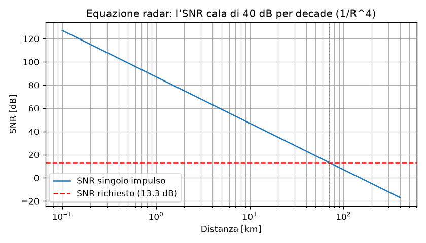

### r02 · Rivelazione a singolo impulso
Soglia di Neyman–Pearson sull'inviluppo, Pfa e Pd stimate con Monte Carlo (inviluppo di Rayleigh e di Rice), confronto con l'approssimazione di Albersheim.
- Per **Pd = 0.9, Pfa = 10⁻⁶** servono circa **13 dB** di SNR.

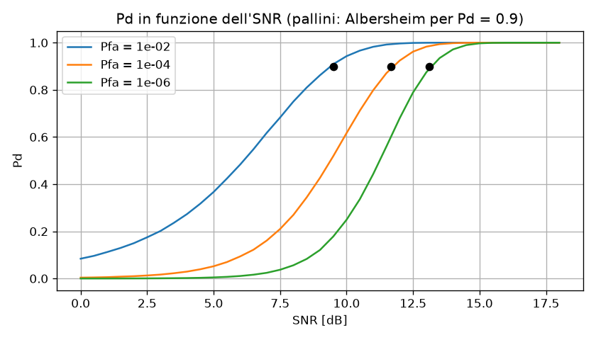

### r03 · Integrazione di impulsi
Rivelatore coerente (somma con compensazione della fase Doppler, cioè un filtro della FFT) contro rivelatore non coerente (energia), a parità di Pfa.
- Con N = 16: guadagno coerente **12.0 dB = 10·log₁₀N**, non coerente 8.8 dB.

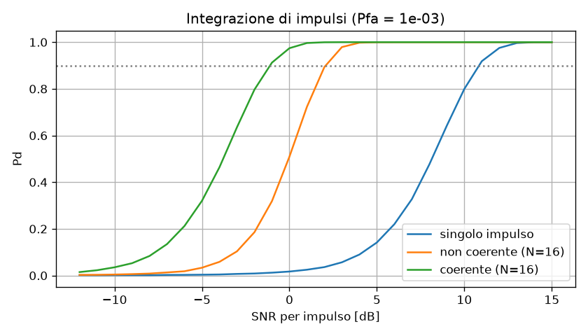

### r04 · Cancellazione del clutter (MTI)
Canceller binomiali di ordine 1–3 contro clutter con spettro gaussiano: attenuazione del clutter e Improvement Factor, con verifica tramite simulazione del clutter correlato.
- IF a PRF/2: **40 / 75 / 108 dB**; la simulazione del canceller singolo coincide con la teoria entro 0.1 dB.

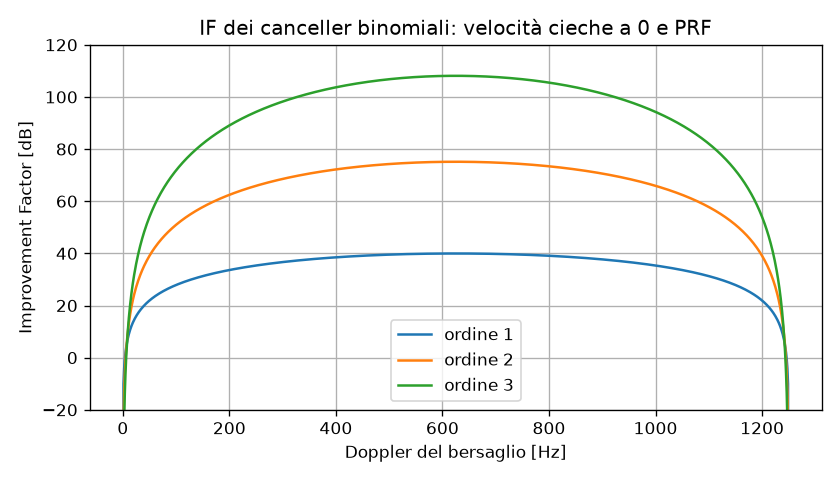

### r05 · Compressione d'impulso e mappa range-Doppler
Chirp con prodotto tempo-banda 30, filtro adattato, treno di 32 impulsi con due bersagli. Compressione in tempo veloce, poi FFT in tempo lento.
- Risoluzione in distanza da **1500 m a 50 m**; entrambi i bersagli localizzati correttamente in distanza e velocità.

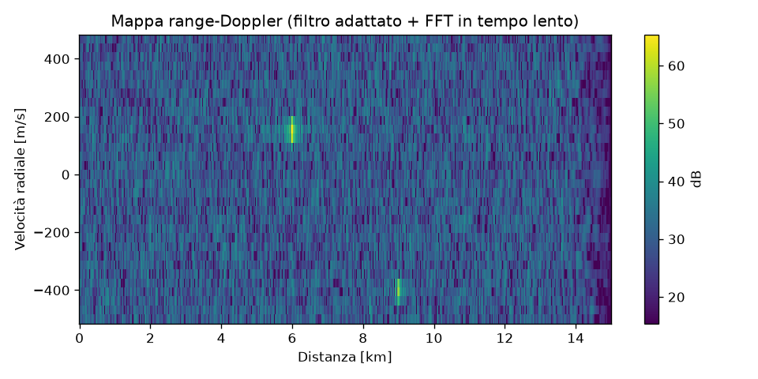

### r06 · SAR: focalizzazione in azimut
Eco di un punto visto da una piattaforma in moto (chirp in tempo lento) e compressione con il filtro adattato.
- Risoluzione lungo traccia da **344 m** (apertura reale) a **0.76 m**, coerente con il limite teorico ≈ d_a/2.

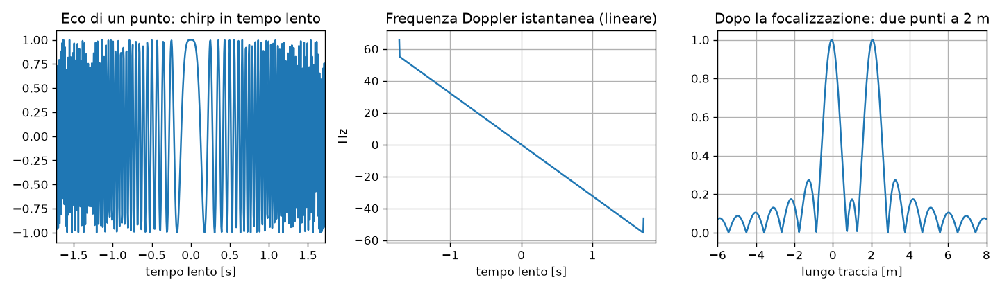

---

## Parte 2 – Elaborazione delle immagini

### i01 · Trasformata di Fourier 2D
Spettro di un'immagine, filtri ideali passa-basso e passa-alto, proprietà di rotazione.

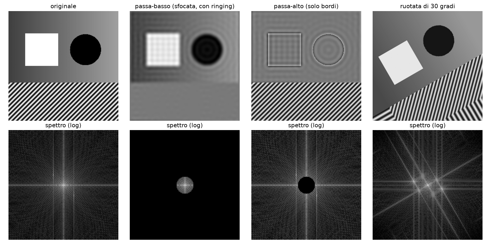

### i02 · Convoluzione tramite DFT e aliasing
Convoluzione circolare contro lineare (zero padding a N₁+N₂−1, errore ~10⁻¹⁶), aliasing nel sottocampionamento e decimazione con filtro anti-aliasing.

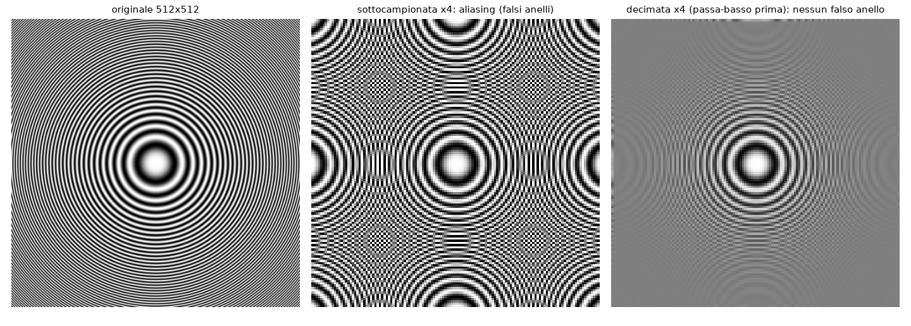

### i03 · Quantizzazione
Quantizzatore uniforme (**+6.02 dB per bit**, misurato da 2 a 8 bit) e quantizzatore ottimo di **Lloyd–Max** per una variabile gaussiana, implementato in modo iterativo.

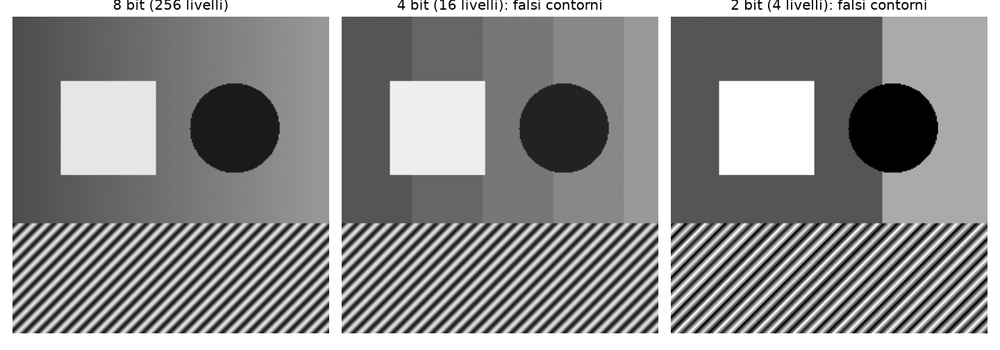

### i04 · Filtraggio spaziale e bordi
Smoothing, sharpening, gradiente di Sobel, Laplaciano; verifica della risposta in frequenza di una maschera 3×3.

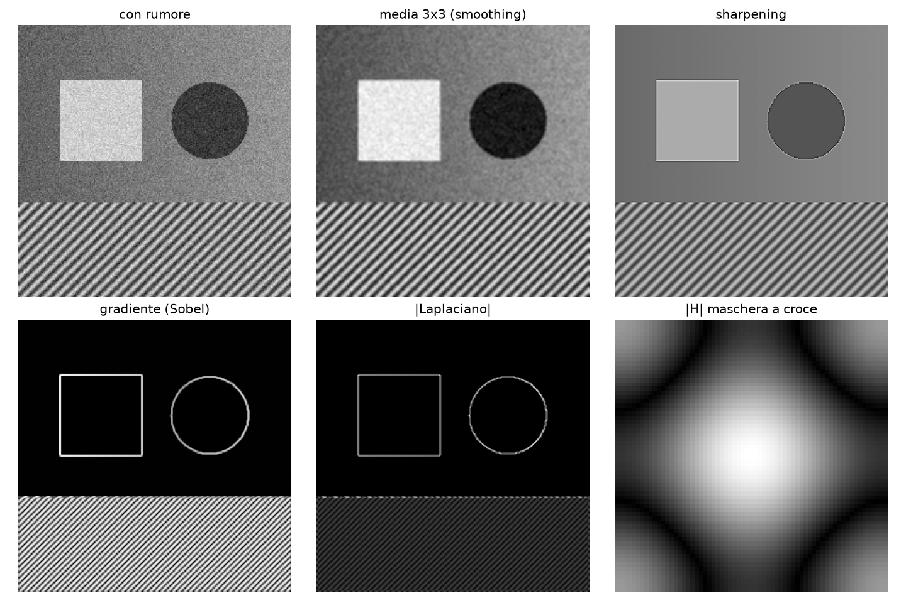

### i05 · Restauro di immagini
Sfocatura da movimento più rumore; confronto tra filtro inverso, pseudo-inverso, minimi quadrati vincolati e filtro di Wiener.
- PSNR: inverso **4.5 dB** (il rumore viene amplificato), Wiener **30.6 dB**.

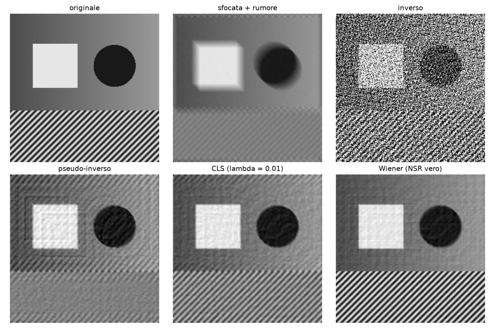

### i06 · KLT, DCT e codifica JPEG
KLT di un caso 2×2, verifica che la DCT approssima la KLT di un processo di Markov, codificatore JPEG semplificato (DCT 8×8 e quantizzazione con la matrice standard).
- **13 %** di coefficienti non nulli con **35.6 dB** di PSNR.

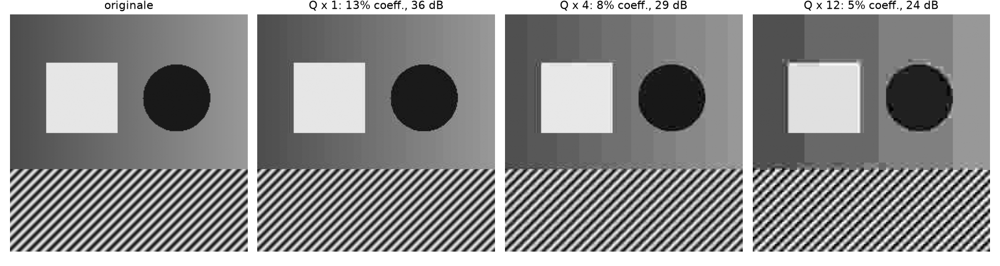

### i07 · Elaborazione di segnali su grafo
Laplaciano di grafo e trasformata di Fourier su grafo (GFT): un segnale liscio concentra il 97 % dell'energia sulle prime tre "frequenze".

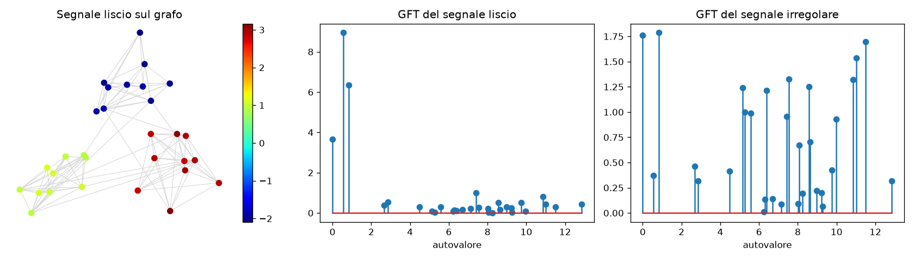

---

## Simulink
`simulink/build_models.m` crea i modelli da codice, usando solo la libreria base:

| Modello | Blocchi principali | Cosa mostra |
|---|---|---|
| `sim_aliasing` | Sine Wave → Zero-Order Hold → To Workspace | un tono a 5 kHz campionato a 8 kHz ricompare a 3 kHz |
| `sim_quantizer` | Sine Wave → Quantizer → Sum | rumore di quantizzazione, SNR ≈ 6.02·b + 1.76 dB |
| `sim_fir_lowpass` | Sine Wave ×2 → Sum → Discrete FIR Filter | filtro passa-basso a finestra di Hamming |
| `sim_mti_canceller` | From Workspace → Unit Delay + Sum, Discrete FIR [1 −3 3 −1] | canceller MTI singolo e triplo |

Costruire i modelli da script, invece che a mano, li rende riproducibili e versionabili con git.

## Scelte implementative
- **Immagini di test sintetiche**: sfumatura, bordi netti e una tessitura periodica, così ogni effetto (ringing, aliasing, perdita di dettaglio) è visibile e lo script non dipende da file esterni.
- **Teoria accanto alla misura**: ogni script stampa entrambi i valori; le differenze sono commentate nel codice. Ad esempio, nel SAR la risoluzione a −3 dB vale 0.886·d_a/2.
- **Seed fissi** per la riproducibilità dei risultati Monte Carlo.

## Prossimi passi
- Validare gli script MATLAB e i modelli Simulink su una release recente di MATLAB.
- Aggiungere un rivelatore CFAR (CA-CFAR) alla mappa range-Doppler.
- Estendere i modelli Simulink con DSP System Toolbox (Buffer, FFT, Spectrum Analyzer) e provare una versione in virgola fissa.
